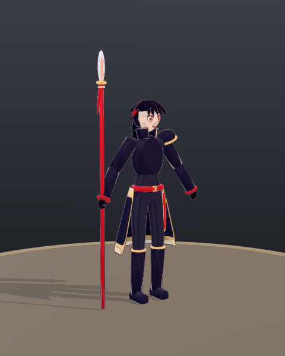
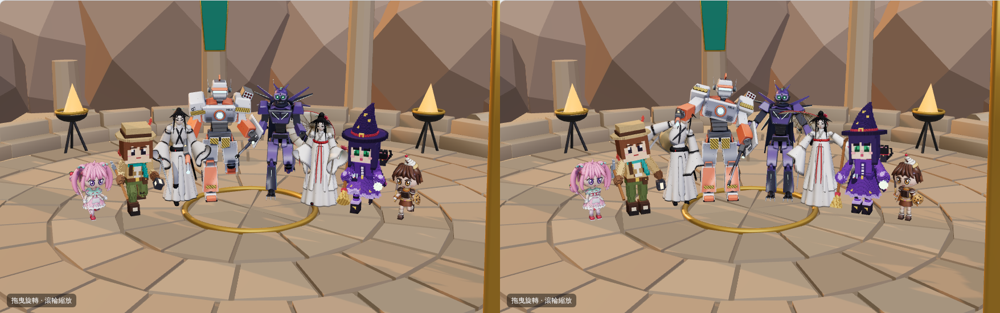
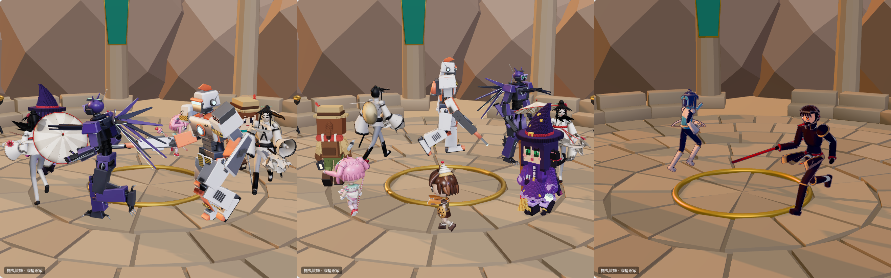
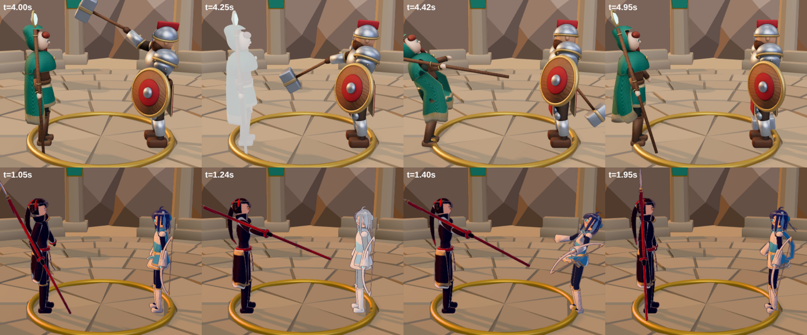
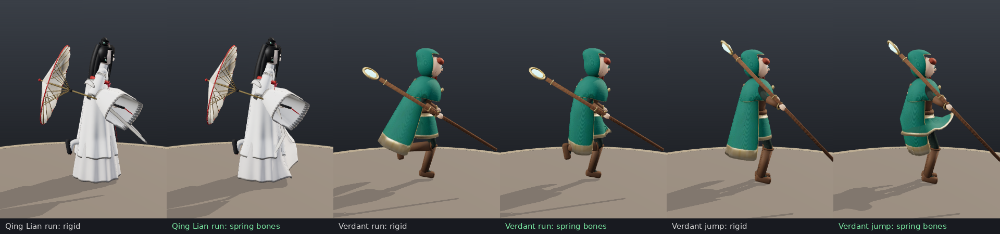
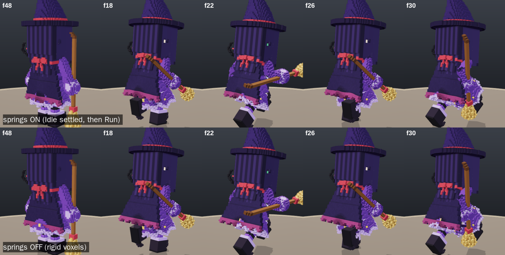
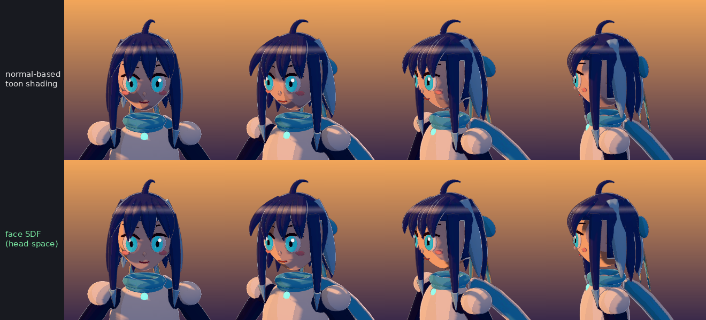
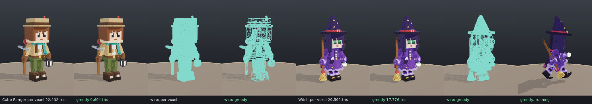
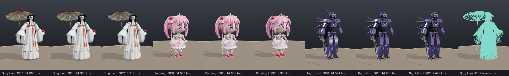
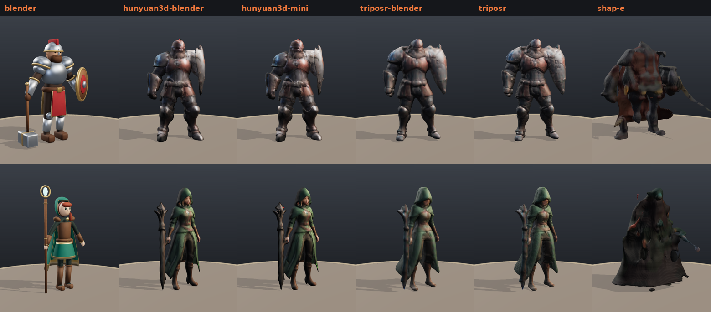

# 3d_model_creator

遊戲用 3D 角色開發：用**免費工具**做出兩個角色，並比較各工具的效果。

| 角色 | 定位 | 檔案 |
|---|---|---|
| 鐵砧・布蘭（anvil） | 重裝先鋒 | `assets/models/blender/anvil.glb` |
| 翠羽・萊拉（verdant） | 秘法遊俠 | `assets/models/blender/verdant.glb` |

- 設計說明：[docs/character_design.md](docs/character_design.md)
- 進度與交接：[docs/PROGRESS.md](docs/PROGRESS.md)
- 給 agent 的說明：[CLAUDE.md](CLAUDE.md)

## 日系動漫角色（原創，卡通渲染）

| 角色 | 定位 | 檔案 |
|---|---|---|
| 蒼嵐・ソラ（sora） | 風之弓手 | `assets/models/anime-blender/sora.glb` |
| 緋槍・カイ（kai） | 炎之槍士 | `assets/models/anime-blender/kai.glb` |

 

程序化建模（`blender/build_anime.py`）：曲線髮束、大眼貼片、天使環髮光、緞帶與圍巾；
卡通渲染在即時 shader 端完成（三階色帶＋描邊＋輪廓光，見 `site/js/viewer.js` 的 `setShading('toon')`）。
技術筆記見 `docs/research.md` §5。

## 四種新風格（更精緻的程序化角色）

| 風格 | 角色（原創） | 腳本 | 重點 |
|---|---|---|---|
| Q版潮玩公仔 | 布丁、可可 | `blender/build_chibi.py` | 164／118 零件、6.5／4.7 萬面、層疊大眼、clearcoat 亮漆、眨眼 morph |
| 科幻機甲硬表面 | 鐵鷹 MK-II、夜梟 RX-9 | `blender/build_mecha.py` | 192／198 零件、切角裝甲＋面板線、活塞、手指、文字標記、斗篷、狙擊槍 |
| 體素藝術 | 方塊遊俠、方塊魔女 | `blender/build_voxel.py` | 27,847／32,505 體素（2 cm）、逐頂點體素 AO、greedy meshing（9.7k／21.2k 面）、免貼圖、魔女斗篷＋長髮物理 |
| 水墨武俠 NPR | 墨白、青蓮 | `blender/build_ink.py` | 廣袖長袍／齊胸襦裙＋油紙傘、即時水墨 shader（墨色三階＋宣紙＋墨線） |

### 動作（所有角色共用動作庫＋各自招式）

| 動作 | 說明 |
|---|---|
| Idle / Walk / Run / Jump / Wave / Hit | `blender/build_character.py` 的 `BASE_CLIPS`，每個程序化角色與 AI 後處理模型自動帶上 |
| 招式 | 鐵砧 Attack、翠羽 Cast、ソラ Shoot、カイ Thrust、布丁 Twirl、可可 Slash、鐵鷹 Aim、夜梟 Snipe、遊俠 Swing、魔女 Cast、墨白 Slash、青蓮 Dance |

競技場選「走路／跑步」時，整組角色會沿場地繞圈（依腿長調整步頻，腳不打滑）：

選「對打」時同組角色兩兩面對面輪流出招。命中時間是**每個招式各自標註**的（類似引擎的 anim notify），
命中瞬間加上格鬥遊戲常用的 hit-stop（雙方凍結 0.08 秒）、受擊閃白、沿攻擊方向擊退再走回原位：

| 招式 | 命中影格（24 fps） | 依據 |
|---|---|---|
| 鐵砧 Attack | 21 | 錘子由上往下掃過正前方（25 格已到身後） |
| 翠羽 Cast／魔女 Cast | 18／20 | 法術放出後數格 |
| ソラ Shoot | 24 | 22 格放箭＋飛行 |
| カイ Thrust | 15 | 長槍完全伸直 |
| 布丁 Twirl | 20 | 魔杖轉到最高點 |
| 可可 Slash／墨白 Slash／遊俠 Swing | 19／16／15 | 刀刃往下劃過正前方 |
| 鐵鷹 Aim／夜梟 Snipe | 23／28 | 開槍（後座力那一格） |
| 青蓮 Dance | 21 | 轉身四分之一圈時廣袖掃過正前方 |

招式函式用 `@bc.hit(影格)` 標註 → 建置時寫進 GLB 的 `animations[].extras.hit`（秒），LOD 也會複製；
viewer 讀進 `clip.userData.hit`。影格是逐格看 filmstrip 判讀的，不是看關鍵影格數字（之前統一 45%：鐵砧還在舉錘、ソラ 還沒放箭就判定命中）。

### 次級動態（spring bones）

披風、裙襬、長髮、飄帶掛在骨鏈上，由 viewer 即時模擬（慣性＋回復力＋重力＋腿部膠囊碰撞），
任何動作都會帶動布料；`render.html?springs=0` 可關閉做對照。實作見 `blender/build_character.py`（`spring()`、
`radial_springs()`、`spring_weights()`）與 `site/js/viewer.js`（`SpringBones`）。

體素魔女的斗篷與長髮也掛上骨鏈。體素原本是「每個體素剛性綁一根骨」，直接綁鏈骨彎曲時方塊之間會裂開；做法：
斗篷／長髮的體素改用**頂點位置**算權重（相鄰體素共用的角點權重完全相同 → 不會裂）、這些面不做 greedy 合併（大面無法彎曲）、
與身體之間保留封閉面（斗篷掀起時看到的是身體表面，不是破洞）；長髮貼在斗篷上，兩者共用同一組鏈 → 不會互穿。
驗證：所有鏈骨各彎 35° 時，可變形區內 1,828 組重合頂點的最大間隙 = 0.0000 mm。

手臂動作以「自然下垂」撰寫，`key_rot()` 依骨架靜止姿勢換成世界軸 → A 字站姿的 Q版與 AI 模型也正確；
揮手會依「手臂長／頭長」自動調整（Q版頭大手短 → 側舉）。互動頁的競技場可切換「動作」。

### 動漫臉部陰影（SDF 式）

卡通渲染時臉部改用「頭部座標＋光線角度」決定明暗分界（類似原神的 SDF 臉部陰影，但完全程序化、不用手繪貼圖），
光線轉動時一條乾淨的分界線掃過臉，不會出現法線造成的碎斑。

### 體素 greedy meshing

### LOD（手機／遠景）

`blender/make_lod.py` 逐零件減面（小零件保留、硬表面先平面溶解），每個角色有 LOD1（1.5 萬面）與 LOD2（約 6 千面），
骨架、動作、物理骨鏈都保留。

## 免費工具比較（全部本機 CPU、$0、不需帳號）

| 做法 | 類型 | 面數 | 貼圖 | 骨架 | 每隻耗時 |
|---|---|---|---|---|---|
| Blender + Python | 程序化建模 | 21k / 24k | 2048 烘焙 PBR | 19 骨 + 動畫 | 48–89 秒（建置） |
| Hunyuan3D-2mini + Blender 後處理 | AI + 自動後處理 | 20k | 2048 烘焙 | 19 骨 + Idle | ~2 分鐘 |
| Hunyuan3D-2mini | 圖 → 3D | 40k | 頂點色（投影） | 無 | ~2 分鐘 |
| TripoSR + Blender 後處理 | AI + 自動後處理 | 20k | 2048 烘焙 | 19 骨 + Idle | < 1 分鐘 |
| TripoSR | 圖 → 3D | 68k–84k | 頂點色 | 無 | 25–50 秒 |
| Shap-E（OpenAI） | 文 → 3D | 88k–102k | 頂點色 | 無 | 11–19 分鐘 |

概念圖：LCM-Dreamshaper-v7（本機 CPU，~40 秒/張）。互動比較頁：`site/index.html`（已發布為 claude.ai artifact，見 `docs/PROGRESS.md`）。
未測試（需帳號）：TRELLIS.2、Hunyuan3D-2.1、Stable Fast 3D、FLUX.1（需免費 HF token）、Tripo API（付費）。
