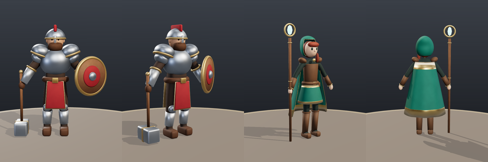

# 3d_model_creator

遊戲用 3D 角色開發：用**免費工具**做出兩個角色，並比較各工具的效果。

| 角色 | 定位 | 檔案 |
|---|---|---|
| 鐵砧・布蘭（anvil） | 重裝先鋒 | `assets/models/blender/anvil.glb` |
| 翠羽・萊拉（verdant） | 秘法遊俠 | `assets/models/blender/verdant.glb` |

- 設計說明：[docs/character_design.md](docs/character_design.md)
- 進度與交接：[docs/PROGRESS.md](docs/PROGRESS.md)
- 給 agent 的說明：[CLAUDE.md](CLAUDE.md)

## 免費工具管線（進行中）
| 工具 | 類型 | 執行位置 | 狀態 |
|---|---|---|---|
| Blender + Python | 程序化建模、骨架、烘焙 | 本機 CPU | ✅ v1 |
| TripoSR（MIT） | 圖 → 3D | 本機 CPU | 進行中 |
| Hunyuan3D-2mini | 圖 → 3D | 本機 CPU | 進行中 |
| TRELLIS.2 / Hunyuan3D-2.1 / SF3D | 圖 → 3D | HF Spaces（免費 GPU 額度） | 需 HF token |
| FLUX.1-schnell | 文 → 概念圖 | HF Spaces | 需 HF token |
